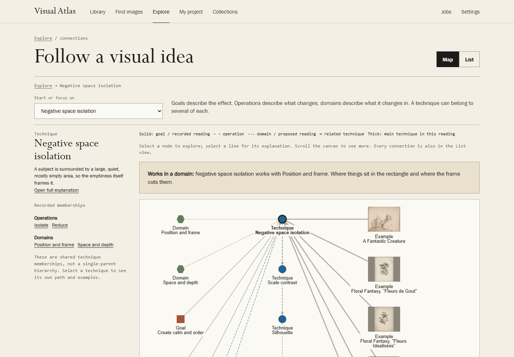

# Visual Atlas

Find images for a brief, understand why they work, and borrow the technique for your own design.

Visual Atlas is a visual research tool for designers, art directors and anyone who works with images. Start with a request such as "make one thing stand out". Explore techniques that could help, look at examples, and compare how different images use the same idea. When you're ready, ask for directions for your own project, with references from your library.

[Try the online demo](https://williamebong.github.io/visual-atlas/) · [Download for Windows](https://github.com/WilliamEbong/visual-atlas/releases/latest) · [User guide](docs/USER-GUIDE.md)

The demo lets you browse without installing anything. Finding new images and asking for advice need the local app. This source tree documents v0.4.0; the public demo and latest downloadable release may be an earlier version.


## Turn a reference into a design decision

A small figure in an empty landscape can suggest solitude. It can also leave room for a title. Visual Atlas helps you examine that choice: where the figure sits, how much space surrounds it, and what changes when you compare it with another image.

Each reference includes observations about the picture, proposed techniques, possible effects, and its source and credit. You can confirm a reading, correct the evidence, or reject it. Your decisions survive later analysis.

The connections view gives you several ways in. Start with a communication goal, an operation such as **Isolate**, or a domain such as **Space and depth**. Follow the links to techniques and examples, select two to four images, and compare them without losing your place.



## Find references worth keeping

Describe what you need in ordinary language. Visual Atlas searches supported museum and archive collections, checks each image's recorded licence, and keeps eligible references with their credits. You can narrow the search by subject, technique, shape or colour, or ask it to fill gaps in your library.

Before you start, the app shows the goals, techniques and subject words it recognised. Change them directly if it has misunderstood you. For example, you can keep "solitude" as the subject while removing an unwanted technique suggestion.

The v0.4 starter pack contains **93 references across 26 techniques**, including paintings, photography, illustration, photomontage and an information graphic. You can explore these immediately, without an AI account. The pack includes CC0, public-domain and CC BY images; [credits](starter/CREDITS.md) record the terms for each one.

## Develop a direction for your project

In **My project**, write the audience, message, format and constraints. An assistant can suggest up to five visual directions, each tied to images already in your library, with execution notes and tradeoffs. Open the references, compare them and keep the useful directions with your brief. Save the reference images in a collection.

Collection exports include images, credits and annotation data. Starter images are reduced copies, up to 1024 pixels on the long side; check the source if you need a larger file for production.

## Start on Windows

1. Download `VisualAtlas-<version>.zip` from [Releases](https://github.com/WilliamEbong/visual-atlas/releases/latest).
2. Right-click the zip, choose **Properties**, and tick **Unblock** if that option appears. Extract it to a short, permanent folder such as `C:\VisualAtlas`.
3. Double-click **Install Visual Atlas.cmd**. The installer adds the starter pack and creates Desktop and Start menu shortcuts.
4. Open **Visual Atlas** and choose **Look around first**. Try **Explore → See connections → Make one thing stand out**.

Your library is stored separately in `%USERPROFILE%\VisualAtlas`. Keep it outside OneDrive and other synced folders. The [user guide](docs/USER-GUIDE.md#install-and-update) covers updates, backups and installation problems. For a shorter walkthrough, see [Quick start](QUICK-START.md).

## Choose when to use AI

Browsing, library search, the connections map, side-by-side comparison and editing your own readings use no AI. Neither does correcting the app's interpretation of a brief.

Finding new images uses an assistant to analyse them. Written comparisons and project directions also use AI. Visual Atlas supports **Codex CLI** and **Claude Code**, signed in with your own account. You can use one assistant, or have a different one check image readings. You do not need a paid API key for these features; calls count against your assistant account's limits.

Your library stays on your computer. Source searches go to the collections you choose. When you request AI work, the picture or text needed for that task goes to OpenAI or Anthropic through the selected assistant. Saved results can be reopened without another call. [Setup and data sharing](docs/USER-GUIDE.md#set-up-an-assistant).

## What to expect

Readings are suggestions. "Agreed by a second model" means two models agreed; it does not mean a person checked the image. The eight new starter readings in v0.4 remain proposed. Figure-ground ambiguity has only two examples, and contemporary graphics and typography are still thin. See the [curation report](docs/evaluation/v0.4/CURATION.md).

Brief interpretation uses word matching. It catches common descriptions but can miss unfamiliar phrasing or misunderstand negation. In the v0.4 held-out evaluation, precision improved from 14/19 to 12/13, while recall fell from 14/20 to 12/20. These are small, model-labelled tests, not expert ratings. The [evaluation report](docs/evaluation/v0.4/BRIEF-REPORT.md) explains the results; the correction controls let you fix a reading before using it.

Licence checks use source records and deterministic rules. Unclear records are skipped, and credits travel with exports. Check an image's **Usage and credits** before publishing: a copyright licence does not settle every question about trademarks, people or your intended use.

## Run from source

You need Git, Node.js 24 and [uv](https://docs.astral.sh/uv/). The project uses Python 3.14, which uv can install.

```sh
git clone https://github.com/WilliamEbong/visual-atlas.git
cd visual-atlas
uv sync
npm --prefix web ci
npm --prefix web run build
uv run atlas starter-import
uv run visual-atlas
```

The Windows installer provides shortcuts. On other platforms, you can run `uv run atlas serve` and open the printed local address in a browser. For a source checkout update, rebuild the frontend and run `uv run atlas starter-import` again; existing references and personal corrections are preserved.

Claude Code and Codex share the same [project instructions](AGENTS.md) and [command-line interface](docs/USER-GUIDE.md#use-the-command-line). The taxonomy and source policies are editable files in [`atlas/data/`](atlas/data/). Feature work follows [Spec Kit](specs/).

To check a development build:

```sh
uv run pytest
uv run ruff check atlas tests scripts
uv run atlas taxonomy check
npm --prefix web run typecheck
npm --prefix web test
npm --prefix web run build
```

[Release notes](docs/RELEASE-v0.4.0.md) · [Verification](docs/evaluation/v0.4/VERIFICATION.md) · [Build state](BUILD-STATE.md)

Software is licensed under [MIT](LICENSE). Images retain their own licences, listed in [starter/CREDITS.md](starter/CREDITS.md).
