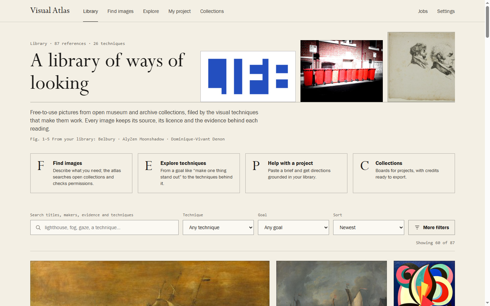
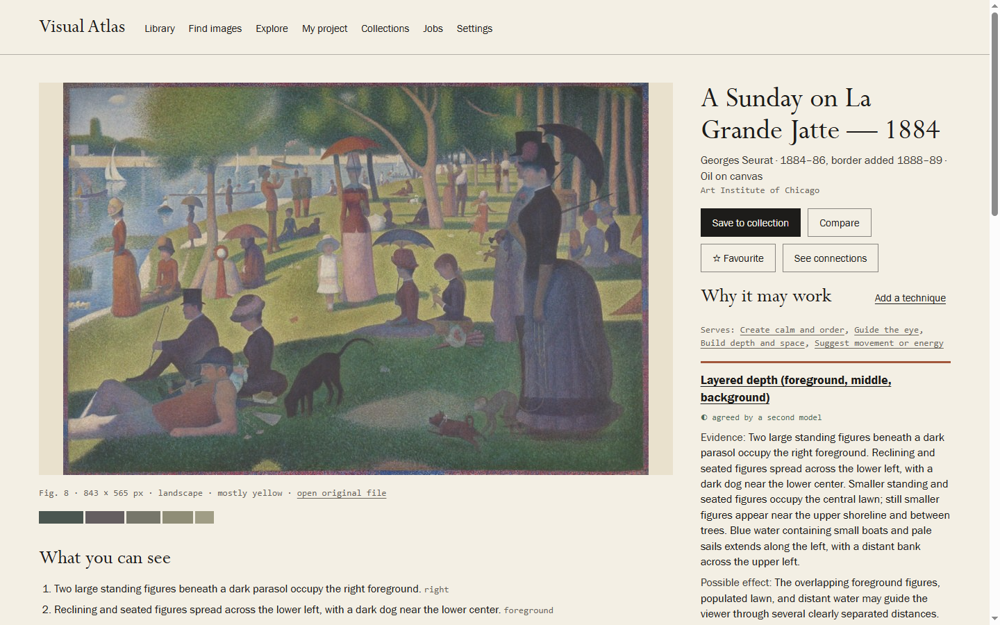
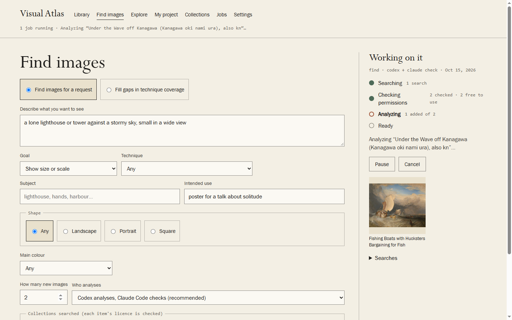
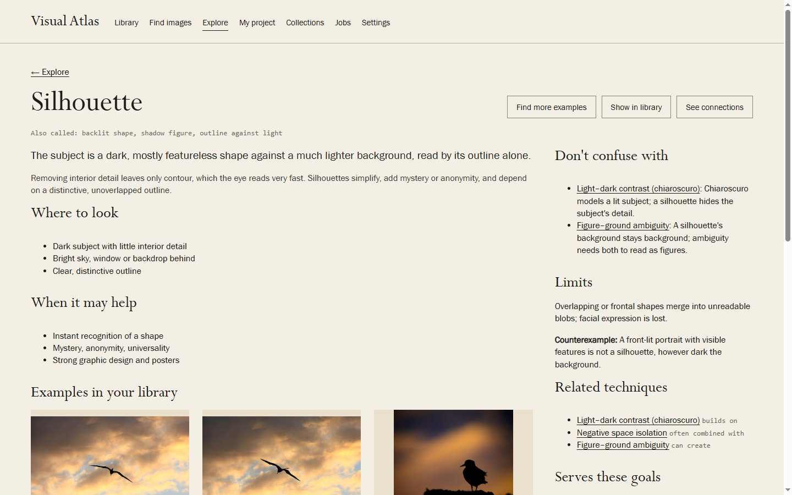
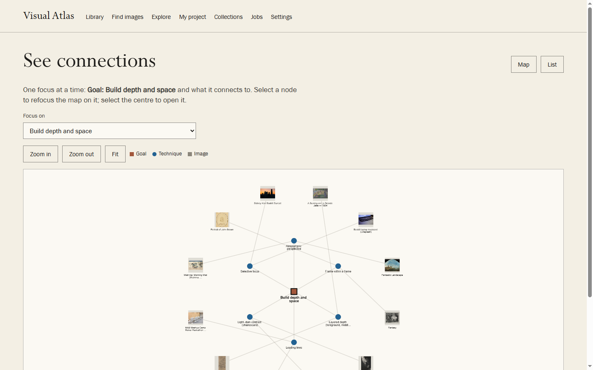
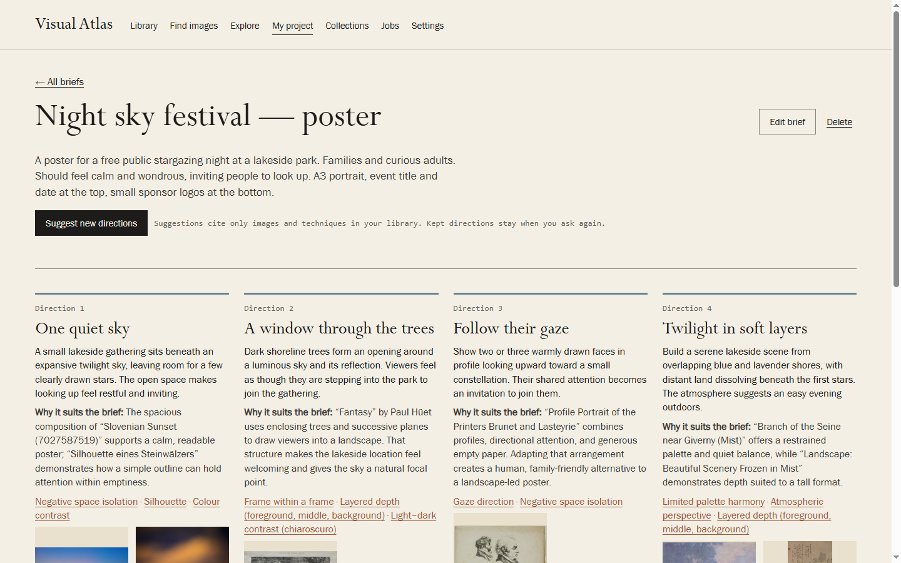
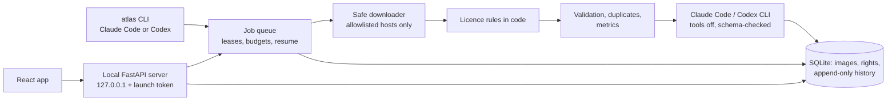

# Visual Atlas

**Find free-to-use images. Learn the techniques that make them work. Use them in your own projects.**

Visual Atlas is a local visual-research library. It searches open museum and archive collections for
you, checks in code that each image's licence lets you keep, show and analyse it, and files every
reference by the visual techniques it uses — negative space, scale contrast, leading lines, gaze
direction and two dozen more. For every image it records what is actually visible, which technique
that evidence points to, and how it may affect a viewer, with an honest review state. Then it helps
you turn those ideas into directions for your own brief.

**[Try the read-only online demo](https://williamebong.github.io/visual-atlas/)** ·
**[Download for Windows](https://github.com/WilliamEbong/visual-atlas/releases/latest)** ·
**[Quick start](QUICK-START.md)** · **[User guide](docs/USER-GUIDE.md)**


## Why Visual Atlas

- **It finds images for you.** Describe what you want to see, or let it *grow your library* where your
  technique examples are thinnest. It searches the Art Institute of Chicago, The Met, the Cleveland
  Museum of Art, Smithsonian Open Access and Wikimedia Commons.
- **Only images you may actually use.** Each item's licence is checked against the source's own record
  by ordinary code — never by an AI. Unclear means skipped. Credits are kept with every image and
  travel into every export. Labels say what was checked (*CC0 — source checked*, *Free with
  attribution — credit included*), never "safe for every use".
- **Evidence before interpretation.** Readings separate the visible evidence, the proposed technique
  and the possible effect. The maker's intention is never guessed: when the source's own record
  describes the work, that text is shown separately, in its own words. Ambiguity is recorded, not
  resolved.
- **Honest review states.** *Proposed by a model* → *agreed by a second model* → *confirmed by you* /
  *rejected*. A second model agreeing is never presented as human review, and your corrections always
  win over later analysis.
- **Analyse once.** Browsing, searching, sorting, collections and comparison never call a model.
- **Your own assistants, your own accounts.** Analysis uses the Claude Code or Codex app already on your
  computer, signed in to your own Claude or ChatGPT plan and run with every tool switched off; there are no API keys
  to manage. Your library stays on your computer, but an AI step is processed by that assistant's service
  (Anthropic or OpenAI): the picture and its catalogue text for an analysis, your words for a search plan, your brief
  and short summaries of library images for project directions. Without AI, nothing but searches leaves the computer.

## A quick tour

### The library
Search, filter by technique, goal, shape, colour, source or review state, and sort. Images lead; the
interface stays out of the way.



### Why an image may work
Numbered observations of the picture, each technique with the evidence it rests on, a hedged effect,
who proposed it and who checked it — and the exact credit line.



### Find images
Plain words plus optional goal, technique, subject, shape, colour, intended use and quantity. Progress
reads Searching → Checking permissions → Analyzing → Ready, with every skipped item explained.



### Explore and see connections
Start from a goal, follow it to techniques and examples, or open a focused map of connections (with a
text list for keyboard and screen-reader users).





### Help with my project
Describe a project and get three to five directions, each built only on techniques and images that
are really in your library, with execution notes and tradeoffs.



## What you get on day one

A starter library of **85 references** covering all **26 techniques**, every one licence-checked at its
source: 69 CC0, 3 public domain and 13 free with attribution (credit included), from Wikimedia Commons
(24), the Art Institute of Chicago (23), the Cleveland Museum of Art (16), Smithsonian Open Access (15) and
The Met (7). Each was analysed by one model and checked by a second (167 readings agreed by both, 46 still
marked as proposed). Starter images are reduced-size copies (at most 1024 px); anything you find yourself
is kept at full size. Credits: [starter/CREDITS.md](starter/CREDITS.md).

## Get started

**On Windows (no terminal):**

1. Download `VisualAtlas-<version>.zip` from [Releases](https://github.com/WilliamEbong/visual-atlas/releases/latest),
   right-click it → **Properties** → tick **Unblock**, and extract it to a folder you keep with a short path
   (for example `C:\VisualAtlas`; very deep folders can exceed Windows's path-length limit).
2. Double-click **Install Visual Atlas**. It installs what it needs, adds the starter library and puts a
   **Visual Atlas** icon on your Desktop and Start menu.
3. Double-click the icon whenever you want to work. Visual Atlas opens in its own window; closing the
   window shuts it down.

**From source (developers, any platform):** with Python 3.14, Node 24, Git and [uv](https://docs.astral.sh/uv/):

```
git clone https://github.com/WilliamEbong/visual-atlas.git
cd visual-atlas
uv sync
npm --prefix web ci
npm --prefix web run build
uv run atlas starter-import
uv run visual-atlas
```

## Choose how AI helps (optional)

| Option | What you need | Used for |
|---|---|---|
| None | Nothing | Browsing, search, filters, collections, comparison, credits, backups |
| Codex | The Codex CLI signed in with your ChatGPT plan (`codex login`) | Analysing images, planning searches, comparisons, project directions |
| Claude Code | Claude Code signed in with your Claude plan (`claude`) | The same, or the second-model check |
| Practice mode | Nothing | Trying the workflow offline (answers are clearly marked as practice) |
| TypeSafe Jev (optional, off by default) | Your own TypeSafe key in the library's `.env` (`TYPESAFE_API_KEY`), switched on in Settings | Reordering which library images are offered for a project brief. Text only: the brief and the images' titles, makers, dates, summaries and technique names go to TypeSafe and are billed to your account. Chosen because it beat the built-in ranking in the [v1.1 evaluation](docs/evaluation/v1.1/REPORT.md); nothing else uses it |

Recommended: Codex analyses and Claude Code checks, which spreads the work across both plans.
Each call runs the official CLI with a fixed command, every tool disabled (no shell, files, web or
browser), an empty temporary folder and a strict answer format; image metadata and text inside images
are passed as untrusted data. A daily limit protects your plan; jobs pause politely when it is reached.

## Where the images come from

| Source | Checked on every item |
|---|---|
| Art Institute of Chicago | `is_public_domain` (CC0) |
| The Met | `isPublicDomain` (CC0) |
| Cleveland Museum of Art | `share_license_status = CC0` |
| Smithsonian Open Access | the image media itself is `CC0` |
| Wikimedia Commons | CC0, public domain or CC BY with author and licence link (no SA, NC or ND) |

Unsplash, Pexels and Pixabay are deliberately **not** used: their terms require hotlinking or restrict
AI and machine-learning use in ways that are unclear for this app. The policy file with evidence links
is [`atlas/data/source_policies.json`](atlas/data/source_policies.json). For a researched list of
free-to-use inspiration sites — and the popular ones that are *not* free to use — see
[docs/FREE-IMAGE-SOURCES.md](docs/FREE-IMAGE-SOURCES.md).

## The taxonomy

An original, editable taxonomy in [`atlas/data/taxonomy.json`](atlas/data/taxonomy.json): goals (what an
image should do), operations (what a technique does), domains (the visual variable it works on) and
techniques, linked many-to-many. Every technique has a definition, how it works, where to look, when it
helps, common confusions and how to tell them apart, limits, a counterexample, related techniques and
background reading; definitions are marked as Visual Atlas's own working definitions. Style, medium,
subject and period are kept separate from technique.

## How it works



- **One database writer** (`atlas/store.py`); rights records, analyses, annotation history, attempts and
  tombstones are append-only (SQLite triggers).
- **Jobs survive anything.** Every step is one recorded state change, so a crash or restart resumes
  without repeating finished work, and a lease stops two workers (the app and an `atlas worker` started
  from Claude Code or Codex) from sharing a job.
- **Local library, remote AI only when you use it.** The server binds to 127.0.0.1, checks Host and Origin and
  requires a per-launch token. Searches go to the collections you choose; AI requests go to the assistant's service
  under your own account. Your library lives in `%USERPROFILE%\VisualAtlas`, outside the app folder and outside OneDrive.

## For Claude Code and Codex

`CLAUDE.md` and `AGENTS.md` are identical, so either agent can maintain and operate the project. The
`atlas` command covers everyday work (`find`, `grow`, `analyze`, `jobs`, `worker`, `credits`, `backup`,
`restore`, `doctor`, `taxonomy check`), and jobs use one shared JSON contract
([`schemas/`](schemas)). The project was planned with GitHub Spec Kit ([`specs/`](specs)).

## Verify it yourself

```
uv run pytest
uv run ruff check atlas tests scripts
uv run atlas taxonomy check
npm --prefix web run typecheck
npm --prefix web test
npm --prefix web run build
```

Build history, decisions and verification evidence: [BUILD-STATE.md](BUILD-STATE.md). Evaluation of the
technique readings, the checker, project-help retrieval and the TypeSafe Jev decision:
[docs/evaluation/v1.1/REPORT.md](docs/evaluation/v1.1/REPORT.md) (the v1 development set is in
[docs/evaluation/HELDOUT.md](docs/evaluation/HELDOUT.md)).

## Known limits

- **Readings are suggestions, not expert judgment.** In the v1.1 evaluation (25 new images; reference readings
  by the builder, not experts) about 8 in 10 proposed techniques were the builder's reading or an acceptable
  alternative, and the second model, now forming its own reading first, still accepted 2 of 5 wrong ones on the
  final split. Treat *proposed* and *agreed by a second model* as starting points, and confirm or correct what
  matters to you ([report](docs/evaluation/v1.1/REPORT.md)).
- **Request coding is conservative.** The built-in reading of a brief rarely tags wrongly but misses techniques
  that are described rather than named; project help still finds relevant references mainly through subject
  words.
- **Near-copies.** Exact and near-identical files are caught; two different frames of the same burst of
  photos can both be added. Remove one with a click if that happens.
- **Smithsonian** works without a key but its shared demo key allows only a few searches an hour; add your
  own free key (`SMITHSONIAN_API_KEY` in `%USERPROFILE%\VisualAtlas\.env`) for more.
- **Windows first.** The installer, shortcut and app window are Windows-only; other platforms run from
  source in a browser.

## Credits and licences

Software: [MIT](LICENSE). The starter library's images keep their own licences; every credit is in
[starter/CREDITS.md](starter/CREDITS.md) and inside the app. Visual Atlas is inspired by the idea of
mapping goals to visual techniques; its taxonomy, content, design and code are original.
